# BridgeWatcher: παρακολούθηση γεφυρών Ισθμού

[](https://github.com/mrjcap/BridgeWatcher/actions/workflows/ci.yml)
[](https://codecov.io/gh/mrjcap/BridgeWatcher)
[](https://app.codacy.com/gh/mrjcap/BridgeWatcher/dashboard?utm_source=gh&utm_medium=referral&utm_content=&utm_campaign=Badge_grade)
[](https://www.powershellgallery.com/packages/BridgeWatcher)
[](https://hub.docker.com/r/mrjcap/bridgewatcher/)
[](https://opensource.org/licenses/MIT)

---

## Περιγραφή

Το BridgeWatcher είναι ένα PowerShell module για την παρακολούθηση της κατάστασης των βυθιζόμενων γεφυρών
Ποσειδωνίας και Ισθμίας στον Ισθμό της Κορίνθου.

Το εργαλείο αντλεί δεδομένα από τον ιστότοπο της διώρυγας, αναγνωρίζει το πρόγραμμα διελεύσεων από ανακοινώσεις
με το [Google Vision API](https://cloud.google.com/vision), στέλνει ειδοποιήσεις push μέσω
[Pushover](https://pushover.net/) όταν αλλάζει η κατάσταση μιας γέφυρας και αποθηκεύει το ιστορικό σε αρχεία JSON.

## Πίνακας περιεχομένων

- [Δυνατότητες](#δυνατότητες)
- [Αρχιτεκτονική](#αρχιτεκτονική)
- [Προϋποθέσεις](#προϋποθέσεις)
- [Εγκατάσταση](#εγκατάσταση)
- [Παραδείγματα χρήσης](#παραδείγματα-χρήσης)
- [Παράμετροι και ρυθμίσεις](#παράμετροι-και-ρυθμίσεις)
- [Δομή δεδομένων](#δομή-δεδομένων)
- [Εξαρτήσεις module](#εξαρτήσεις-module)
- [Αντιμετώπιση προβλημάτων](#αντιμετώπιση-προβλημάτων)
- [Άδεια χρήσης και συνεισφορά](#άδεια-χρήσης-και-συνεισφορά)
- [Οδικός χάρτης ανάπτυξης](#οδικός-χάρτης-ανάπτυξης)
- [Συχνές ερωτήσεις](#συχνές-ερωτήσεις)

## Δυνατότητες

- Ανάκτηση κατάστασης γεφυρών από τον ιστότοπο της διώρυγας.
- Αναγνώριση κειμένου (OCR) από εικόνες ανακοινώσεων μέσω Google Vision API.
- Αποστολή ειδοποιήσεων push μέσω Pushover σε αλλαγή κατάστασης.
- Εξαγωγή στιγμιοτύπων κατάστασης σε αρχεία JSON.
- Παραμετροποίηση συχνότητας ελέγχου και μέγιστου αριθμού επαναλήψεων.
- Σουίτα δοκιμών με Pester v5 και κάλυψη κώδικα 100%.
- Αυτοματοποιημένη ροή CI/CD για έλεγχο, δόμηση και δημοσίευση.

## Αρχιτεκτονική

```mermaid
flowchart TD

subgraph group_monitoring["Παρακολούθηση και ενορχήστρωση"]
  node_monitor["Παρακολούθηση κατάστασης"]
  node_update["Ενορχηστρωτής ενημέρωσης κατάστασης"]
  node_status["Ανάκτηση κατάστασης"]
end

subgraph group_analysis["Ανάλυση κατάστασης και αποθήκευση"]
  node_prev_status["Ανάγνωση προηγούμενης κατάστασης"]
  node_html_analysis["Ανάλυση κατάστασης από HTML"]
  node_status_object["Αντικείμενο κατάστασης και hash εικόνας"]
  node_comparison["Σύγκριση κατάστασης"]
  node_snapshot_export["Εξαγωγέας στιγμιοτύπου"]
  node_state_file[("Στιγμιότυπο κατάστασης JSON")]
end

subgraph group_dispatch["Δρομολόγηση ειδοποιήσεων και OCR"]
  node_closed_handler["Διαχειριστής ειδοποίησης κλεισίματος"]
  node_opened_handler["Διαχειριστής ειδοποίησης ανοίγματος"]
  node_ocr["Αίτημα OCR Google Cloud"]
  node_ocr_parser["Αναλυτής προγράμματος και οδηγιών OCR"]
  node_pushover_sender["Αποστολέας ειδοποίησης Pushover"]
end

node_operator(("Χειριστής"))
node_bridge_source["Πηγή πληροφοριών γεφυρών"]
node_vision["API Google Vision"]
node_pushover["API Pushover"]

node_operator -->|"εκκίνηση βρόχου ελέγχου"| node_monitor
node_monitor -->|"εκτέλεση ανά μεσοδιάστημα"| node_update
node_update -->|"φόρτωση προηγούμενης κατάστασης"| node_prev_status
node_prev_status -->|"ανάγνωση"| node_state_file
node_update -->|"ανάκτηση ζωντανής κατάστασης"| node_status
node_status -->|"λήψη HTML"| node_bridge_source
node_status -->|"ανάλυση τμημάτων γεφυρών"| node_html_analysis
node_html_analysis -->|"δόμηση κατάστασης και hash εικόνας"| node_status_object
node_status_object -.->|"λήψη δεδομένων εικόνας προγράμματος"| node_bridge_source
node_update <-->|"αποστολή καταστάσεων / λήψη συμβάντων διαφοράς"| node_comparison
node_update -.->|"αποστολή συμβάντος κλεισίματος"| node_closed_handler
node_update -.->|"αποστολή συμβάντος ανοίγματος"| node_opened_handler
node_closed_handler -.->|"αίτημα OCR για προγραμματισμένο κλείσιμο"| node_ocr
node_ocr -->|"αποστολή URI εικόνας"| node_vision
node_ocr -->|"ανάλυση χρονοσημάνσεων και οδηγιών"| node_ocr_parser
node_closed_handler -->|"αποστολή ειδοποίησης κλεισίματος"| node_pushover_sender
node_opened_handler -->|"αποστολή ειδοποίησης ανοίγματος"| node_pushover_sender
node_pushover_sender -->|"παράδοση ειδοποίησης push"| node_pushover
node_update -->|"αποθήκευση τελευταίας κατάστασης"| node_snapshot_export
node_snapshot_export -->|"ατομική εγγραφή"| node_state_file

click node_monitor "https://github.com/mrjcap/bridgewatcher/blob/main/BridgeWatcher/Public/Get-BridgeStatusMonitor.ps1"
click node_update "https://github.com/mrjcap/bridgewatcher/blob/main/BridgeWatcher/Public/Update-BridgeStatus.ps1"
click node_status "https://github.com/mrjcap/bridgewatcher/blob/main/BridgeWatcher/Public/Get-BridgeStatus.ps1"
click node_prev_status "https://github.com/mrjcap/bridgewatcher/blob/main/BridgeWatcher/Public/Get-BridgePreviousStatus.ps1"
click node_html_analysis "https://github.com/mrjcap/bridgewatcher/blob/main/BridgeWatcher/Private/Get-BridgeStatusFromHtml.ps1"
click node_status_object "https://github.com/mrjcap/bridgewatcher/blob/main/BridgeWatcher/Private/Get-BridgeStatusObject.ps1"
click node_comparison "https://github.com/mrjcap/bridgewatcher/blob/main/BridgeWatcher/Public/Invoke-BridgeStatusComparison.ps1"
click node_snapshot_export "https://github.com/mrjcap/bridgewatcher/blob/main/BridgeWatcher/Private/Export-BridgeStatusJson.ps1"
click node_closed_handler "https://github.com/mrjcap/bridgewatcher/blob/main/BridgeWatcher/Private/Invoke-BridgeClosedNotification.ps1"
click node_opened_handler "https://github.com/mrjcap/bridgewatcher/blob/main/BridgeWatcher/Private/Invoke-BridgeOpenedNotification.ps1"
click node_ocr "https://github.com/mrjcap/bridgewatcher/blob/main/BridgeWatcher/Private/Invoke-BridgeOCRGoogleCloud.ps1"
click node_ocr_parser "https://github.com/mrjcap/bridgewatcher/blob/main/BridgeWatcher/Private/ConvertFrom-BridgeOCRResult.ps1"
click node_pushover_sender "https://github.com/mrjcap/bridgewatcher/blob/main/BridgeWatcher/Public/Send-BridgePushover.ps1"

classDef toneBlue fill:#dbeafe,stroke:#2563eb,stroke-width:1.5px,color:#172554
classDef toneAmber fill:#fef3c7,stroke:#d97706,stroke-width:1.5px,color:#78350f
classDef toneMint fill:#dcfce7,stroke:#16a34a,stroke-width:1.5px,color:#14532d
classDef toneIndigo fill:#e0e7ff,stroke:#4f46e5,stroke-width:1.5px,color:#312e81

class node_monitor,node_update,node_status toneBlue
class node_prev_status,node_html_analysis,node_status_object,node_comparison,node_snapshot_export,node_state_file toneAmber
class node_closed_handler,node_opened_handler,node_ocr,node_ocr_parser,node_pushover_sender toneMint
class node_operator,node_bridge_source,node_vision,node_pushover toneIndigo
```



## Προϋποθέσεις

### Απαραίτητες παράμετροι

Πριν από την εκτέλεση του BridgeWatcher χρειάζονται τα εξής στοιχεία:

| Απαίτηση | Περιγραφή | Πηγή απόκτησης |
| -------- | --------- | -------------- |
| Google Vision API Key | Κλειδί πρόσβασης για τις κλήσεις OCR | [Google Cloud Console](https://console.cloud.google.com/) |
| Pushover API Key | Κλειδί εφαρμογής για αποστολή ειδοποιήσεων | [Pushover Dashboard](https://pushover.net/apps) |
| Pushover User Key | Κλειδί χρήστη ή ομάδας παραληπτών | [Pushover Account](https://pushover.net/) |
| Pushover Client | Εφαρμογή λήψης ειδοποιήσεων | [iOS](https://apps.apple.com/us/app/pushover-notifications/id506088175) / [Android](https://play.google.com/store/apps/details?id=net.superblock.pushover) |

### Απαιτήσεις συστήματος

- PowerShell 5.1 ή νεότερο, συνιστάται PowerShell Core 7 και νεότερο
- Windows, macOS ή Linux
- Σύνδεση στο διαδίκτυο

## Εγκατάσταση

### Μέθοδος 1: PowerShell Gallery

```powershell
# Εγκατάσταση για τον τρέχοντα χρήστη
Install-Module -Name BridgeWatcher -Scope CurrentUser

# Εγκατάσταση για όλους τους χρήστες (απαιτεί δικαιώματα διαχειριστή)
Install-Module -Name BridgeWatcher -Scope AllUsers
```

### Μέθοδος 2: χειροκίνητη εγκατάσταση από το GitHub

```powershell
# Κλωνοποίηση του αποθετηρίου
git clone https://github.com/mrjcap/BridgeWatcher.git

# Μετάβαση στον φάκελο
cd BridgeWatcher

# Φόρτωση του module
Import-Module ./BridgeWatcher.psd1 -Force
```

## Παραδείγματα χρήσης

### Παράδειγμα 1: εκκίνηση συνεχούς παρακολούθησης

```powershell
# Δημιουργία ρυθμίσεων και παράμετροι συνεχούς ελέγχου
$config = New-BridgeConfiguration
$params = @{
    Configuration   = $config
    MaxIterations   = 0           # 0 για απεριόριστες επαναλήψεις
    IntervalSeconds = 600         # Έλεγχος κάθε 10 λεπτά (600 δευτερόλεπτα)
    PoApiKey        = 'your-pushover-api-key'
    PoUserKey       = 'your-pushover-user-key'
    ApiKey          = 'your-google-vision-api-key'
    OutputFile      = './BridgeStatusSnapshot.json'
}

# Εκκίνηση παρακολούθησης
Get-BridgeStatusMonitor @params
```

### Παράδειγμα 2: άμεση ανάκτηση κατάστασης

```powershell
# Δημιουργία ρυθμίσεων
$config = New-BridgeConfiguration

# Απλή εκτέλεση
Get-BridgeStatus -Configuration $config

# Αναλυτική καταγραφή
Get-BridgeStatus -Configuration $config -Verbose

# Αποθήκευση σε μεταβλητή και προβολή πίνακα
$status = Get-BridgeStatus -Configuration $config
$status | Format-Table -AutoSize
```

### Παράδειγμα 3: περιορισμένη παρακολούθηση

```powershell
# Παρακολούθηση για 24 ώρες με έλεγχο κάθε 30 λεπτά (48 επαναλήψεις)
$config = New-BridgeConfiguration
$params = @{
    Configuration   = $config
    MaxIterations   = 48
    IntervalSeconds = 1800
    PoApiKey        = $env:PUSHOVER_API_KEY
    PoUserKey       = $env:PUSHOVER_USER_KEY
    ApiKey          = $env:GOOGLE_VISION_API_KEY
    OutputFile      = ".\logs\BridgeStatus_$(Get-Date -Format 'yyyyMMdd').json"
}

Get-BridgeStatusMonitor @params
```

---

#### Σημειώσεις και πρακτικές ασφαλείας

- Περιορίστε τα δικαιώματα πρόσβασης σε αρχεία ρυθμίσεων και μυστικών στο σύστημα αρχείων.
- Σε περιβάλλοντα αυτοματισμού ή CI/CD, αποθηκεύστε τα κλειδιά σε μεταβλητές περιβάλλοντος ή σε διαχειριστή μυστικών,
  όπως [GitHub Actions Secrets](https://docs.github.com/en/actions/security-guides/encrypted-secrets) ή
  [Azure Key Vault](https://learn.microsoft.com/en-us/azure/key-vault/general/).
- Μην καταγράφετε μυστικά κλειδιά και διακριτικά πρόσβασης σε αρχεία καταγραφής.
- Για οδηγίες ασφάλειας αυθεντικοποίησης, ανατρέξτε στο
  [NIST SP 800-53 IA-5](https://nvlpubs.nist.gov/nistpubs/SpecialPublications/NIST.SP.800-53r5.pdf).

---

## Παράμετροι και ρυθμίσεις

### Παράμετροι Get-BridgeStatusMonitor

| Παράμετρος | Τύπος | Περιγραφή | Προεπιλογή |
| ---------- | ----- | --------- | ---------- |
| `Configuration` | PSCustomObject | Αντικείμενο ρυθμίσεων από τη `New-BridgeConfiguration` | - |
| `MaxIterations` | int | Αριθμός επαναλήψεων, 0 για απεριόριστες | 100 |
| `IntervalSeconds` | int | Δευτερόλεπτα αναμονής μεταξύ ελέγχων | 300 |
| `PoApiKey` | string | Pushover API Token | - |
| `PoUserKey` | string | Pushover User Key | - |
| `ApiKey` | string | Google Vision API Key | - |
| `OutputFile` | string | Διαδρομή αρχείου εξαγωγής JSON | - |

## Δομή δεδομένων

### Παράδειγμα εξόδου JSON

```json
[
    {
        "GefyraName": "Ισθμία",
        "GefyraStatus": "Ανοιχτή",
        "ImageUrl": "https://www.topvision.gr/dioriga/image-bridge-open-no-schedule.php?1748373632",
        "Timestamp": "2025-05-27T22:20:32.1076961+03:00"
    },
    {
        "GefyraName": "Ποσειδωνία",
        "GefyraStatus": "Ανοιχτή",
        "ImageUrl": "https://www.topvision.gr/dioriga/image-bridge-open-no-schedule.php?1748373632",
        "Timestamp": "2025-05-27T22:20:32.1076961+03:00"
    }
]
```

## Εξαρτήσεις module

Το BridgeWatcher δεν απαιτεί εξωτερικές βιβλιοθήκες κατά την εκτέλεση:

- Παραγωγή: καμία εξωτερική εξάρτηση.
- Δοκιμές: Pester v5 για την εκτέλεση των δοκιμών μονάδας.

## Αντιμετώπιση προβλημάτων

### Κοινά προβλήματα και λύσεις

#### Αποτυχία σύνδεσης στον ιστότοπο

```powershell
# Έλεγχος δικτυακής σύνδεσης προς τον ιστότοπο
Test-NetConnection -ComputerName "www.topvision.gr" -Port 443
```

#### Αποτυχία αποστολής ειδοποίησης Pushover

```powershell
# Δοκιμαστική αποστολή ειδοποίησης Pushover
$config = New-BridgeConfiguration
Send-BridgePushover -Configuration $config -PoApiKey $PoApiKey -PoUserKey $PoUserKey -Message "Test" -Verbose
```

### Λειτουργία αποσφαλμάτωσης

```powershell
# Ενεργοποίηση αναλυτικής καταγραφής στην κονσόλα
$VerbosePreference = "Continue"
Get-BridgeStatusMonitor @params -Verbose

# Καταγραφή σε αρχείο αποσφαλμάτωσης
Start-Transcript -Path ".\debug_log.txt"
Get-BridgeStatusMonitor @params -Verbose
Stop-Transcript
```

## Άδεια χρήσης και συνεισφορά

- Άδεια: [MIT License](LICENSE)
- Συγγραφέας: Γιάννης Καπλατζής
- Αποθετήριο: [GitHub mrjcap/BridgeWatcher](https://github.com/mrjcap/BridgeWatcher)
- Συνεισφορά: υποβολή pull requests και αναφορών σφαλμάτων στο GitHub.

### Διαδικασία συνεισφοράς

1. Δημιουργήστε ένα fork του αποθετηρίου.
2. Δημιουργήστε νέο κλαδί (`git checkout -b feature/NewFeature`).
3. Καταχωρίστε τις αλλαγές (`git commit -m 'feat: add NewFeature'`).
4. Προωθήστε το κλαδί (`git push origin feature/NewFeature`).
5. Ανοίξτε νέο Pull Request.

## Οδικός χάρτης ανάπτυξης

### Ολοκληρωμένα

- [x] Βασικές συναρτήσεις module
- [x] Ενσωμάτωση OCR με Google Vision
- [x] Αποστολή ειδοποιήσεων Pushover
- [x] Πλήρης σουίτα δοκιμών Pester v5
- [x] Ροή ελέγχων CI στο GitHub Actions
- [x] Δημοσίευση στο PowerShell Gallery
- [x] Δημιουργία και δημοσίευση εικόνας Docker
- [x] Αναφορές κάλυψης κώδικα στο Codecov
- [x] Αυτόματη ενημέρωση Changelog στα ελληνικά
- [x] Αυτόματη παραγωγή τεκμηρίωσης με platyPS και markdownlint
- [x] Ροή CI/CD με έκδοση και έλεγχο ταυτότητας
- [x] Στατική ανάλυση κώδικα και σάρωση ασφαλείας Docker με Codacy και Trivy
- [x] Επαναχρησιμοποιήσιμες ροές εργασίας GitHub Actions
- [x] Αυτόματος υπολογισμός επόμενης έκδοσης
- [x] Κεντρική διαχείριση release gates και orchestrator

### Μελλοντικά χαρακτηριστικά

- [ ] Τελικό σημείο REST API

## Συχνές ερωτήσεις

### Πόσο συχνά πρέπει να ελέγχεται η κατάσταση των γεφυρών

Έλεγχος κάθε 5 έως 10 λεπτά (300 έως 600 δευτερόλεπτα) αρκεί για να καταγράφονται οι αλλαγές χωρίς περιττή επιβάρυνση.

### Μπορεί να χρησιμοποιηθεί το module σε Linux ή macOS

Ναι, το BridgeWatcher λειτουργεί σε PowerShell Core 7 και νεότερο σε Windows, Linux και macOS.

### Πώς αποθηκεύονται τα κλειδιά API με ασφάλεια

```powershell
# Χρήση μεταβλητών περιβάλλοντος
$env:GOOGLE_VISION_API_KEY = "your-key"
$env:PUSHOVER_API_KEY = "your-key"
$env:PUSHOVER_USER_KEY = "your-key"

# Χρήση του module SecretManagement
Install-Module Microsoft.PowerShell.SecretManagement
Set-Secret -Name "GoogleVisionKey" -Secret "your-key"
```

### Υποστηρίζει το module άλλες υπηρεσίες ειδοποιήσεων

Η τρέχουσα έκδοση υποστηρίζει μόνο το Pushover.
