# 🌉 BridgeWatcher: Προηγμένη Παρακολούθηση Γεφυρών Ισθμού

[](https://github.com/mrjcap/BridgeWatcher/actions/workflows/ci.yml)
[](https://github.com/mrjcap/BridgeWatcher/actions/workflows/docker-build.yml)
[](https://github.com/mrjcap/BridgeWatcher/actions/workflows/powershell-docs.yml)
[](https://github.com/mrjcap/BridgeWatcher/actions/workflows/publish.yml)
[](https://github.com/mrjcap/BridgeWatcher/actions/workflows/release.yml)
[](https://github.com/mrjcap/BridgeWatcher/issues)
[](https://codecov.io/gh/mrjcap/BridgeWatcher)
[](https://app.codacy.com/gh/mrjcap/BridgeWatcher/dashboard?utm_source=gh&utm_medium=referral&utm_content=&utm_campaign=Badge_grade)
[](https://pester.dev/)
[](https://www.powershellgallery.com/packages/BridgeWatcher)
[](https://www.powershellgallery.com/packages/BridgeWatcher)
[](https://hub.docker.com/r/mrjcap/bridgewatcher/)


[](https://opensource.org/licenses/MIT)

---

## 📖 Περιγραφή

Το **BridgeWatcher** αποτελεί ένα υψηλής εξειδίκευσης και
πλήρως αυτοματοποιημένο PowerShell module,
σχεδιασμένο με σκοπό την αξιόπιστη εποπτεία της λειτουργικής κατάστασης
των γεφυρών **Ποσειδωνίας** και **Ισθμίας** στον Ισθμό της Κορίνθου.

Με την αξιοποίηση τεχνικών HTML scraping και Οπτικής Αναγνώρισης Χαρακτήρων (OCR)

μέσω του [Google Vision API](https://cloud.google.com/vision),

το σύστημα διενεργεί σε βάθος ανάλυση δεδομένων σε πραγματικό χρόνο,

αποστέλλει κρίσιμες ειδοποιήσεις μέσω της πλατφόρμας

[Pushover](https://pushover.net/) και διατηρεί ιστορικό καταγραφών σε μορφή JSON
για εκ των υστέρων επεξεργασία και αξιολόγηση.

## 📋 Πίνακας Περιεχομένων

- [💡 Δυνατότητες](#-δυνατότητες)
- [🏗️ Αρχιτεκτονική](#️-αρχιτεκτονική)
- [🛠️ Προϋποθέσεις](#️-προϋποθέσεις)
- [📦 Εγκατάσταση](#-εγκατάσταση)
- [🚀 Παραδείγματα Χρήσης](#-παραδείγματα-χρήσης)
- [⚙️ Παράμετροι & Ρυθμίσεις](#️-παράμετροι--ρυθμίσεις)
- [📊 Δομή Δεδομένων](#-δομή-δεδομένων)
- [🧩 Εξαρτήσεις Module](#-εξαρτήσεις-module)
- [🔧 Troubleshooting](#-troubleshooting)
- [📝 Άδεια Χρήσης & Συμμετοχή](#-άδεια-χρήσης--συμμετοχή)
- [🗺️ Οδικός Χάρτης Ανάπτυξης](#️-οδικός-χάρτης-ανάπτυξης)
- [❓ Συχνές Ερωτήσεις (FAQ)](#-συχνές-ερωτήσεις-faq)

## 💡 Δυνατότητες

- ✅ **Αυτοματοποιημένη ανάκτηση δεδομένων** από την επίσημη διαδικτυακή πηγή
- ✅ **OCR ανάλυση** με εξελιγμένους αλγορίθμους για ακριβή εξαγωγή χρονικών παραμέτρων
- ✅ **Push notifications** με στιγμιαία αποστολή προσαρμοσμένων ειδοποιήσεων
- ✅ Ιστορικό καταγραφών με δημιουργία στιγμιοτύπων σε μορφή JSON
- ✅ **Ευέλικτη παραμετροποίηση** διαστημάτων παρακολούθησης
- ✅ Πλήρης κάλυψη δοκιμών με testing framework (Pester v5)
- ✅ **CI/CD ready** με απόλυτη συμβατότητα για συνεχή ενσωμάτωση

## 🏗️ Αρχιτεκτονική

```mermaid
flowchart TD

subgraph group_monitoring["Monitoring & Orchestration"]
  node_monitor["Status Monitor"]
  node_update["Status Update Orchestrator"]
  node_status["Status Retrieval"]
end

subgraph group_analysis["State Analysis & Persistence"]
  node_prev_status["Previous State Reader"]
  node_html_analysis["HTML Status Analysis"]
  node_status_object["Status Object & Image Hasher"]
  node_comparison["Pure Status Comparison"]
  node_snapshot_export["Snapshot Exporter"]
  node_state_file[("Bridge State Snapshot JSON")]
end

subgraph group_dispatch["Notification Dispatch & OCR"]
  node_closed_handler["Closed Notification Handler"]
  node_opened_handler["Opened Notification Handler"]
  node_ocr["Google Cloud OCR Request"]
  node_ocr_parser["OCR Schedule & Advice Parser"]
  node_pushover_sender["Pushover Notification Sender"]
end

node_operator(("Operator"))
node_bridge_source["Bridge Information Source"]
node_vision["Google Vision API"]
node_pushover["Pushover API"]

node_operator -->|"starts polling loop"| node_monitor
node_monitor -->|"invokes every interval"| node_update
node_update -->|"loads prior state"| node_prev_status
node_prev_status -->|"reads"| node_state_file
node_update -->|"fetches live state"| node_status
node_status -->|"downloads HTML"| node_bridge_source
node_status -->|"parses bridge blocks"| node_html_analysis
node_html_analysis -->|"builds state & hashes schedule"| node_status_object
node_status_object -.->|"downloads schedule image bytes"| node_bridge_source
node_update <-->|"passes states / receives Bridge Diff Events"| node_comparison
node_update -.->|"dispatches Closed event"| node_closed_handler
node_update -.->|"dispatches Opened event"| node_opened_handler
node_closed_handler -.->|"requests OCR on scheduled closure"| node_ocr
node_ocr -->|"sends image URI"| node_vision
node_ocr -->|"parses timestamps & advice"| node_ocr_parser
node_closed_handler -->|"sends closure alert"| node_pushover_sender
node_opened_handler -->|"sends opening alert"| node_pushover_sender
node_pushover_sender -->|"delivers push notification"| node_pushover
node_update -->|"persists latest state"| node_snapshot_export
node_snapshot_export -->|"atomically overwrites"| node_state_file

click node_monitor "https://github.com/mrjcap/bridgewatcher/blob/main/BridgeWatcher/Public/Get-BridgeStatusMonitor.ps1"
click node_update "https://github.com/mrjcap/bridgewatcher/blob/main/BridgeWatcher/Public/Update-BridgeStatus.ps1"
click node_status "https://github.com/mrjcap/bridgewatcher/blob/main/BridgeWatcher/Public/Get-BridgeStatus.ps1"
click node_prev_status "https://github.com/mrjcap/bridgewatcher/blob/main/BridgeWatcher/Public/Get-BridgePreviousStatus.ps1"
click node_html_analysis "https://github.com/mrjcap/bridgewatcher/blob/main/BridgeWatcher/Private/Get-BridgeStatusFromHtml.ps1"
click node_status_object "https://github.com/mrjcap/bridgewatcher/blob/main/BridgeWatcher/Private/Get-BridgeStatusObject.ps1"
click node_comparison "https://github.com/mrjcap/bridgewatcher/blob/main/BridgeWatcher/Public/Invoke-BridgeStatusComparison.ps1"
click node_snapshot_export "https://github.com/mrjcap/bridgewatcher/blob/main/BridgeWatcher/Private/Export-BridgeStatusJson.ps1"
click node_closed_handler "https://github.com/mrjcap/bridgewatcher/blob/main/BridgeWatcher/Private/Invoke-BridgeClosedNotification.ps1"
click node_opened_handler "https://github.com/mrjcap/bridgewatcher/blob/main/BridgeWatcher/Private/Invoke-BridgeOpenedNotification.ps1"
click node_ocr "https://github.com/mrjcap/bridgewatcher/blob/main/BridgeWatcher/Private/Invoke-BridgeOCRGoogleCloud.ps1"
click node_ocr_parser "https://github.com/mrjcap/bridgewatcher/blob/main/BridgeWatcher/Private/ConvertFrom-BridgeOCRResult.ps1"
click node_pushover_sender "https://github.com/mrjcap/bridgewatcher/blob/main/BridgeWatcher/Public/Send-BridgePushover.ps1"

classDef toneBlue fill:#dbeafe,stroke:#2563eb,stroke-width:1.5px,color:#172554
classDef toneAmber fill:#fef3c7,stroke:#d97706,stroke-width:1.5px,color:#78350f
classDef toneMint fill:#dcfce7,stroke:#16a34a,stroke-width:1.5px,color:#14532d
classDef toneIndigo fill:#e0e7ff,stroke:#4f46e5,stroke-width:1.5px,color:#312e81

class node_monitor,node_update,node_status toneBlue
class node_prev_status,node_html_analysis,node_status_object,node_comparison,node_snapshot_export,node_state_file toneAmber
class node_closed_handler,node_opened_handler,node_ocr,node_ocr_parser,node_pushover_sender toneMint
class node_operator,node_bridge_source,node_vision,node_pushover toneIndigo
```



## 🛠️ Προϋποθέσεις

### 📄 Απαραίτητες Παράμετροι

Προτού ξεκινήσεις την αξιοποίηση του **BridgeWatcher**,
βεβαιώσου ότι έχεις εξασφαλίσει τα ακόλουθα:

| Απαίτηση | Περιγραφή | Πώς να το αποκτήσεις |
| -------- | --------- | -------------------- |
| **Google Vision API Key** | Απαραίτητο για OCR λειτουργίες | [Google Cloud Console](https://console.cloud.google.com/) |
| **Pushover API Key** | Για αποστολή ειδοποιήσεων | [Pushover Dashboard](https://pushover.net/apps) |
| **Pushover User Key** | Για προσωποποιημένες ειδοποιήσεις | [Pushover Account](https://pushover.net/) |
| **Pushover Mobile App** | Για λήψη ειδοποιήσεων | [iOS](https://apps.apple.com/us/app/pushover-notifications/id506088175) / [Android](https://play.google.com/store/apps/details?id=net.superblock.pushover) |

### 💻 Απαιτήσεις Συστήματος

- PowerShell 5.1 ή νεότερο
- Windows, macOS ή Linux
- Σύνδεση στο διαδίκτυο

## 📦 Εγκατάσταση

### Μέθοδος 1: PowerShell Gallery (Προτεινόμενη)

```powershell
# Εγκατάσταση για τον τρέχοντα χρήστη
Install-Module -Name BridgeWatcher -Scope CurrentUser

# Εγκατάσταση για όλους τους χρήστες (απαιτεί admin)
Install-Module -Name BridgeWatcher -Scope AllUsers
```

### Μέθοδος 2: Χειροκίνητη εγκατάσταση από GitHub

```powershell
# Κλωνοποίηση του repository
git clone https://github.com/mrjcap/BridgeWatcher.git

# Μετάβαση στον φάκελο
cd BridgeWatcher

# Φόρτωση του module
Import-Module ./BridgeWatcher.psd1 -Force
```

## 🚀 Παραδείγματα Χρήσης

### Παράδειγμα 1: Εκκίνηση συνεχούς παρακολούθησης

```powershell
# Δημιουργία hashtable με παραμέτρους
$params = @{
    MaxIterations      = 0           # 0 = άπειρες επαναλήψεις
    IntervalSeconds    = 600         # Έλεγχος κάθε 10 λεπτά
    PoApiKey           = 'your-pushover-api-key'
    PoUserKey          = 'your-pushover-user-key'
    ApiKey             = 'your-google-vision-api-key'
    OutputFile         = './BridgeStatusSnapshot.json'
}

# Εκκίνηση παρακολούθησης
Get-BridgeStatusMonitor @params
```

### Παράδειγμα 2: Άμεση ανάκτηση κατάστασης

```powershell
# Απλή κλήση
Get-BridgeStatus

# Με verbose output για debugging
Get-BridgeStatus -Verbose

# Αποθήκευση σε μεταβλητή για περαιτέρω επεξεργασία
$status = Get-BridgeStatus
$status | Format-Table -AutoSize
```

### Παράδειγμα 3: Περιορισμένη παρακολούθηση

```powershell
# Παρακολούθηση για 24 ώρες με έλεγχο κάθε 30 λεπτά
$params = @{
    MaxIterations      = 48          # 24 ώρες / 30 λεπτά = 48 επαναλήψεις
    IntervalSeconds    = 1800        # 30 λεπτά = 1800 δευτερόλεπτα
    PoApiKey           = $env:PUSHOVER_API_KEY
    PoUserKey          = $env:PUSHOVER_USER_KEY
    ApiKey             = $env:GOOGLE_VISION_API_KEY
    OutputFile         = ".\logs\BridgeStatus_$(Get-Date -Format 'yyyyMMdd').json"
}

Get-BridgeStatusMonitor @params
```

---

#### ⚡ Σημειώσεις & Best Practices

- Ο φάκελος του κωδικού (`C:\automation\passwd.xml`) πρέπει να είναι προστατευμένος με NTFS δικαιώματα.
- Το vault παραμένει ξεκλείδωτο για όσο έχεις ορίσει στο `PasswordTimeout`.
- Για cloud ή Linux/macOS automation προτίμησε secrets provider της πλατφόρμας (π.χ.
  [GitHub Actions Secrets](https://docs.github.com/en/actions/security-guides/encrypted-secrets),
  [Azure Key Vault](https://learn.microsoft.com/en-us/azure/key-vault/general/)).
- Μην καταγράφεις ποτέ τα secrets σε log files.
- Για auditability και compliance, δες
  [NIST SP 800-53 - IA-5](https://nvlpubs.nist.gov/nistpubs/SpecialPublications/NIST.SP.800-53r5.pdf).

---

## ⚙️ Παράμετροι & Ρυθμίσεις

### Get-BridgeStatusMonitor Parameters

| Παράμετρος | Τύπος | Περιγραφή | Προεπιλογή |
| ---------- | ----- | --------- | ---------- |
| `MaxIterations` | int | Αριθμός επαναλήψεων (0 = άπειρες) | 0 |
| `IntervalSeconds` | int | Χρονικό διάστημα μεταξύ ελέγχων | 600 |
| `PoApiKey` | string | Pushover API Key | - |
| `PoUserKey` | string | Pushover User Key | - |
| `ApiKey` | string | Google Vision API Key | - |
| `OutputFile` | string | Διαδρομή αρχείου JSON | ./BridgeStatusSnapshot.json |

## 📊 Δομή Δεδομένων

### Παράδειγμα JSON Output

```json
[
    {
        "GefyraName": "Ισθμία",
        "GefyraStatus": "Ανοιχτή",
        "ImageUrl": "https://www.topvision.gr/dioriga/image-bridge-open-no-schedule.php?1748373632",
        "Timestamp": "2025-05-27T22:20:32.1076961+03:00"
    },
    {
        "GefyraName": "Ποσειδωνία",
        "GefyraStatus": "Ανοιχτή",
        "ImageUrl": "https://www.topvision.gr/dioriga/image-bridge-open-no-schedule.php?1748373632",
        "Timestamp": "2025-05-27T22:20:32.1076961+03:00"
    }
]
```

## 🧩 Εξαρτήσεις Module

Το **BridgeWatcher** έχει αναπτυχθεί ως αυτάρκες module χωρίς εξωτερικές εξαρτήσεις:

- ✅ **Παραγωγή**: Καμία εξωτερική εξάρτηση
- 🧪 **Ανάπτυξη/Testing**: Pester v5 (για unit tests)

## 🔧 Troubleshooting

### Κοινά Προβλήματα & Λύσεις

#### 🔴 Σφάλμα: "Cannot connect to bridge status website"

```powershell
# Έλεγχος σύνδεσης
Test-NetConnection -ComputerName "www.topvision.gr" -Port 443

```

#### 🔴 Σφάλμα: "Pushover notification failed"

```powershell
# Δοκιμή Pushover connection
Send-BridgePushover -Token $PoApiKey -User $PoUserKey -Message "Test" -Verbose
```

### Debug Mode

```powershell
# Ενεργοποίηση verbose logging
$VerbosePreference = "Continue"
Get-BridgeStatusMonitor @params -Verbose

# Αποθήκευση debug log
Start-Transcript -Path ".\debug_log.txt"
Get-BridgeStatusMonitor @params -Verbose
Stop-Transcript
```

## 📝 Άδεια Χρήσης & Συμμετοχή

- **📜 Άδεια**: [MIT License](LICENSE)
- **👨‍💻 Συγγραφέας**: Γιάννης Καπλατζής
- **🔗 Repository**: [GitHub: mrjcap/BridgeWatcher](https://github.com/mrjcap/BridgeWatcher)
- **🤝 Συνεισφορά**: Pull Requests και Issues είναι ευπρόσδεκτα!

### Πώς να συνεισφέρεις

1. Fork το repository
2. Δημιούργησε ένα feature branch (`git checkout -b feature/AmazingFeature`)
3. Commit τις αλλαγές σου (`git commit -m 'Add some AmazingFeature'`)
4. Push στο branch (`git push origin feature/AmazingFeature`)
5. Άνοιξε ένα Pull Request

## 🗺️ Οδικός Χάρτης Ανάπτυξης

### ✅ Ολοκληρωμένα

- [x] Βασική λειτουργικότητα module
- [x] OCR integration με Google Vision
- [x] Pushover notifications
- [x] Ολοκληρωμένη κάλυψη μέσω Pester tests
- [x] Ενσωμάτωση GitHub Actions για CI
- [x] Δημοσίευση στο PowerShell Gallery
- [x] Δημιουργία Docker Image
- [x] Υποστήριξη Codecov
- [x] Αυτοματοποιημένο Changelog σε ελληνικά με PowerShell scripts
- [x] Αυτοματοποιημένη τεκμηρίωση μέσω platyPS και markdownlint
- [x] Ασφαλές, modular CI/CD με version pinning, reproducibility και audit trail
- [x] Σαφής έλεγχος ποιότητας και ασφάλειας: Codacy, Trivy Docker scan
- [x] Επαναχρησιμοποιήσιμα workflows
- [x] Αυτόματη πρόβλεψη επόμενης έκδοσης
- [x] Κεντρική διαχείριση release gates, cleanup & orchestrator στο pipeline

### 📅 Μελλοντικά

- [ ] REST API endpoint

## ❓ Συχνές Ερωτήσεις (FAQ)

### Πόσο συχνά πρέπει να ελέγχω την κατάσταση των γεφυρών

- Συνιστάται έλεγχος κάθε 5-10 λεπτά.

### Μπορώ να χρησιμοποιήσω το module σε Linux/macOS

- Ναι! Το BridgeWatcher είναι συμβατό με PowerShell (7+).

### Πώς μπορώ να αποθηκεύσω τα API keys με ασφάλεια

```powershell
# Χρήση environment variables
$env:GOOGLE_VISION_API_KEY = "your-key"
$env:PUSHOVER_API_KEY = "your-key"
$env:PUSHOVER_USER_KEY = "your-key"

# Ή χρήση SecretManagement module
Install-Module Microsoft.PowerShell.SecretManagement
Set-Secret -Name "GoogleVisionKey" -Secret "your-key"
```

### Υποστηρίζει το module άλλες υπηρεσίες ειδοποιήσεων

- Προς το παρόν υποστηρίζεται μόνο το Pushover.

---

Φτιαγμένο με ❤️ στην Ελλάδα
